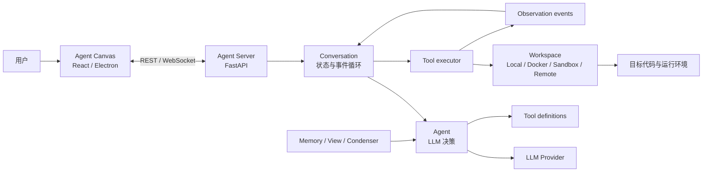
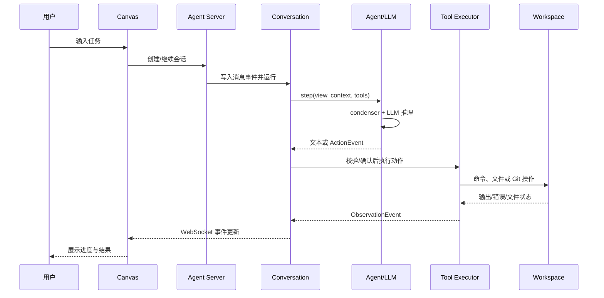

# OpenHands 架构研究

> 研究快照：2026-10-13。事实来自固定的两个官方 submodule；图中的顺序是对源码的结构化归纳。

## 1. 总体架构



主要控制流为：Canvas 发起或继续会话；Agent Server 管理会话与工作区；Conversation 驱动循环；Agent 结合事件视图、记忆、压缩后的上下文和工具定义请求 LLM；工具执行器在 Workspace 中执行动作，再把观察结果写回事件流。

## 2. Agent 架构

核心入口是 [`agent.py`](../software-agent-sdk/openhands-sdk/openhands/sdk/agent/agent.py) 中的 `Agent`。关键步骤如下：

1. Conversation 调用 `Agent.step()` / `Agent.astep()`。
2. Agent 先处理待确认的动作，并为当前步骤构造动态上下文和历史 View。
3. condenser 的 `prepare_llm_messages()` 把可用事件整理为模型消息；必要时压缩较早历史。
4. Agent 向 LLM 发送消息、工具 schema 和相关元数据，并可要求安全风险预测。
5. 模型响应被分类为普通文本、推理内容或工具调用。
6. 工具调用被转成动作事件；执行结果则成为观察事件，供下一轮推理使用。

Conversation 的本地实现位于 [`local_conversation.py`](../software-agent-sdk/openhands-sdk/openhands/sdk/conversation/impl/local_conversation.py)。它负责：

- 运行/暂停/停止状态；
- 最大轮数和预算限制；
- 卡死检测与停止钩子；
- 工具确认；
- Agent 步骤、异常与事件写入。

这表明 `Agent` 主要负责“决定下一步”，Conversation 负责“让多个步骤成为可管理的生命周期”。

## 3. Planner

### 已确认事实

当前快照中没有一个统领所有任务的通用 `Planner` 核心类。规划能力主要以 **Agent preset + prompt section + 专用工具** 实现：

- [`planning.py`（preset）](../software-agent-sdk/openhands-tools/openhands/tools/preset/planning.py) 创建普通 `Agent`，配置 Glob、Grep 和 Planning File Editor 等工具。
- [`planning.py`（prompt section）](../software-agent-sdk/openhands-sdk/openhands/sdk/context/prompts/sections/planning.py) 提供理解、规划、综合和完善等阶段提示。
- [`planning_file_editor`](../software-agent-sdk/openhands-tools/openhands/tools/planning_file_editor/) 将写入范围限制为 `PLAN.md`。
- preset 使用 `LLMSummarizingCondenser` 控制较长规划会话的上下文。

### 人工理解

“Planner”不应被理解为 Agent 之外的固定中央调度器。默认 Agent 本身会逐步决定动作；Planning Agent 是为了代码库探索和计划产出而收窄工具集合、强化提示规则的一种配置。这种实现比独立 Planner 类更灵活，但规划质量仍依赖 LLM、提示和当前上下文。

## 4. Memory

OpenHands 中“Memory”至少有三层含义，阅读时不能混为一谈。

### 4.1 持久记忆文件

[`context/memory.py`](../software-agent-sdk/openhands-sdk/openhands/sdk/context/memory.py) 加载两级 `MEMORY.md`：

- 用户级：`~/.openhands/memory/MEMORY.md`
- 项目级：`<workspace>/.openhands/memory/MEMORY.md`

两者共享字符预算；当前快照默认总预算为 6000 字符。超限时从较早的顶部内容开始裁剪，项目级内容排在后面，因而更靠近模型当前注意位置。按日期命名的记忆文件不会自动全部加载，需要按需读取。

### 4.2 会话事件与上下文压缩

Conversation 保留追加式事件历史；View 选择本轮可见事件；condenser 将较早的一段历史总结为 condensation event，同时保留底层事件日志的可追溯性。它解决的是模型上下文窗口问题，不等同于长期知识库。

### 4.3 内存存储实现

[`io/memory.py`](../software-agent-sdk/openhands-sdk/openhands/sdk/io/memory.py) 是进程内 `FileStore`/缓存实现。它是基础设施层的“内存存储”，不是 Agent 的语义记忆系统。

### 尚未验证

本阶段没有确认长期记忆在真实任务中的召回准确率，也没有发现向量数据库式语义检索是默认必经路径。不能仅凭类名推断 OpenHands 具有完整的长期自主记忆能力。

## 5. Tool 调用

核心抽象见 [`tool.py`](../software-agent-sdk/openhands-sdk/openhands/sdk/tool/tool.py)：

- `ToolDefinition`：不可变的 Pydantic 模型，包含动作 schema、观察 schema、说明和 executor，并支持导出为 MCP 工具。
- `ToolExecutor`：具体执行器遵循的抽象接口。
- 动作/观察事件：将 LLM 的意图与真实执行结果分开记录。

调用链可概括为：

```text
ToolDefinition schemas
    → LLM tool call
    → ActionEvent
    → 风险判断 / 用户确认
    → _ActionBatch / ParallelToolExecutor
    → Workspace 或外部服务
    → ObservationEvent
    → Conversation event log
    → 下一轮 Agent.step()
```

[`parallel_executor.py`](../software-agent-sdk/openhands-sdk/openhands/sdk/agent/parallel_executor.py) 使用线程池并行执行允许并发的动作，并通过资源锁避免多个动作同时破坏共享资源；同时支持取消令牌。内置工具集合包括终端、文件编辑、Glob/Grep、浏览器、MCP、任务委派、Finish/Think、Skills 等，但具体可用集合由 Agent 配置决定。

## 6. Runtime 与 Workspace

### 已确认事实

SDK 的 [`workspace.py`](../software-agent-sdk/openhands-sdk/openhands/sdk/workspace/workspace.py) 定义基础 Workspace 能力，包括命令执行、上传/下载、Git 状态与差异等。扩展包提供：

- `LocalWorkspace`：直接访问并执行宿主机资源；
- `DockerWorkspace`：Docker 容器工作区；
- `AgentSandboxWorkspace`：Agent Sandbox；
- `ApptainerWorkspace`：Apptainer 环境；
- `OpenHandsCloudWorkspace`：OpenHands Cloud；
- `APIRemoteWorkspace`：通过 API 使用远端工作区。

Agent Server 位于 [`openhands-agent-server`](../software-agent-sdk/openhands-agent-server/)，使用 FastAPI 路由提供 conversation、event、workspace、runtime、bash、file、git、MCP、settings 等服务。Canvas 的 `src/api` 层将 UI 请求适配到这些服务。

### 风险

`LocalWorkspace` 和 Canvas 的本地开发模式可能把宿主文件系统与命令执行能力直接交给 Agent。对于不受信任的仓库、提示或工具调用，隔离式 Workspace 通常更稳妥。具体隔离强度仍需在未来运行阶段结合容器配置、挂载、网络和密钥策略验证，不能仅凭接口名称认定安全。

## 7. 关键数据流



## 8. 架构判断

- **已确认**：事件驱动会话、LLM 决策、schema 化工具、Workspace 抽象、Canvas/Server 分离均有源码与官方文档支持。
- **合理推测**：事件日志与工具边界让调试和回放比把所有状态藏在一个循环中更容易，但实际可观测性取决于部署时保留的日志与遥测。
- **未验证**：多 Agent 扩展在真实负载下的调度效果、远程 Runtime 的可靠性、安全确认能否覆盖所有危险路径，以及并发工具对复杂共享状态的保护程度。
