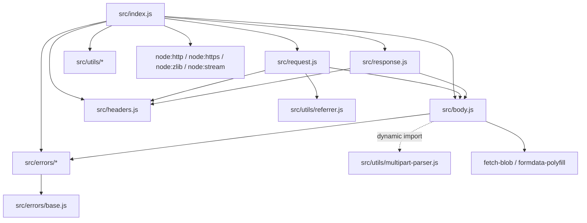

# REA 第一次真实开源项目分析：node-fetch

> 测试日期：2026-10-13  
> REA submodule：`4773c152bc5f299fa682575bb8d1efea7587c7bc`  
> Node.js：`v24.18.0`  
> 分析对象：`node-fetch/node-fetch`  
> 目标 commit：`8b3320d2a7c07bce4afc6b2bf6c3bbddda85b01f`  
> 最终判定：**PARTIAL——REA 完成证据化文件清点，但当前 Windows 源码构建缺少原生控制层，AST 语义分析未完成。**

## 1. 目标与判定标准

本次目标不是证明“REA 能自动读懂所有代码”，而是验证它是否能帮助理解一个真实 GitHub 开源项目，并明确区分：

- **REA 已确认事实**：来自本次 Evidence JSON；
- **人工源码核验**：根据固定 commit 的源码逐文件检查；
- **合理推测**：基于静态结构的解释，未经过运行时验证；
- **未验证信息**：本次环境或范围没有覆盖。

判定标准：

1. 能固定目标版本并识别项目文件；
2. 能提供可追溯的 Evidence、摘要和覆盖状态；
3. 能帮助定位入口、模块关系和关键数据流；
4. limitations 必须明确，不能把 partial 当作 complete；
5. 不执行目标代码，不修改 REA 源码。

## 2. 为什么选择 node-fetch

目标仓库：[node-fetch/node-fetch](https://github.com/node-fetch/node-fetch)。本次固定到 [commit `8b3320d`](https://github.com/node-fetch/node-fetch/tree/8b3320d2a7c07bce4afc6b2bf6c3bbddda85b01f)，不使用会随时间变化的浮动主分支结论。

### 已确认事实

| 项目 | 结果 |
| --- | --- |
| 语言 | 现代 ESM JavaScript，附 TypeScript 声明 |
| 包版本 | `3.1.1` |
| License | MIT，仓库包含 `LICENSE.md` |
| 文档 | README、`docs/`、CONTRIBUTING、SECURITY 均存在 |
| 仓库规模 | 53 个 tracked 文件，其中 25 个 JS/TS 文件 |
| 核心源码规模 | `src/` 下 13 个文件，约 2,124 行 |
| npm 入口 | `package.json` 的 `main` 为 `./src/index.js` |
| Node 要求 | `^12.20.0 || ^14.13.1 || >=16.0.0` |
| 运行依赖 | `data-uri-to-buffer`、`fetch-blob`、`formdata-polyfill` |

### 主观判断

这个规模适合第一次学习：核心源码不至于大到难以核对，同时覆盖 URL/请求规范化、HTTP/HTTPS、流、重定向、压缩解码、错误传播和 Web API 兼容层，架构关系比最小示例更有代表性。

## 3. 实际执行

工作目录：

```text
D:\AI-tools-lab\rea-study\rea
```

目标目录：

```text
D:\AI-tools-lab\rea-study\examples\first-real-analysis\target\node-fetch
```

命令：

```powershell
& "D:\tools\node-v24.18.0-win-x64\node.exe" `
  "scripts/rea.mjs" `
  "analyze-javascript-application" `
  "D:\AI-tools-lab\rea-study\examples\first-real-analysis\target\node-fetch" `
  "--artifact-format" "directory" `
  "--format" "json" `
  "--full-output"
```

实际结果：

```text
退出码：1
错误代码：capability_unavailable
错误分类：unsupported_provider
结果性质：包含 partial_observation 的合法 JSON error envelope
```

失败原因：

```text
REA Windows native controls are unavailable:
ENOENT: no such file or directory, open
'D:\AI-tools-lab\rea-study\rea\native\windows\build\manifest.json'
```

这不是 node-fetch 源码错误。REA 官方 [`native/windows/README.md`](../rea/native/windows/README.md) 说明 Windows 原生件使用单独的 Linux + MinGW-w64 构建通道；默认 `npm run build:cached` 不生成它。本机没有 WSL distribution，也没有 `x86_64-w64-mingw32-g++`，本次没有安装大型工具链。

## 4. REA 实际完成了什么

### 4.1 Evidence 身份

以下字段来自 REA 返回的 `partial_observation`：

| 字段 | 值 |
| --- | --- |
| Evidence ID | `ev_62e7963f2179cc95594ad00b9979562160ad1c6349724bb2e8ad9ba450a74a5d` |
| Provider | `rea-javascript-application` / `REA JavaScript application analyzer` / version `1` |
| Subject | `node-fetch`，格式 `directory` |
| Subject / root artifact SHA-256 | `2b9b251628b7024d7b16dfde605920ff6da81c6cf3b92bd4631e055061a53130` |
| Inventory manifest ID | `agm_c0d03354b4312868b06fe0d5b93895eae81e919bb9c4fdf6754efcf1311bac71` |
| Inventory graph SHA-256 | `02d5db757ad17527a073984cb05bd95c31fe9ea17f58bf9a0cd2a52846bd32d9` |
| Authority | `shipped-artifact` |
| Confidence | `derived` |

### 4.2 清点结果

REA 返回：

- 26 个 relevant files；
- 读取 220,283 字节文本；
- application graph 为 `JavaScriptApplicationGraph`；
- 53 个 graph nodes：25 个 `javascript-asset`、26 个 `unknown`、2 个 `artifact`；
- 52 条 application graph 边，现有边主要表达目录包含文件或 unavailable parse scope；
- graph coverage 为 `partial`，没有截断，但遗漏数量未知；
- semantic graph 中保留 25 个 module 节点、0 条语义关系、300 个 unknown；
- `parsed_javascript_files=0`、`visited_ast_nodes=0`。

因此，REA 在本次运行中可靠完成的是**文件级 inventory 与 Evidence 定位**，不是函数级语义恢复。

### 4.3 关键文件 Evidence 示例

| 文件 | 字节数 | REA 记录的 SHA-256 |
| --- | ---: | --- |
| `src/index.js` | 13,325 | `702dacfbf11259fb64ce8bb75326e58187c0670d375f37f034b35c8dac6b76a7` |
| `src/body.js` | 10,247 | `56b49482fc5a5582a984d125fed3edeb2ea73a480c57336557bac26c58a54edd` |
| `src/request.js` | 8,932 | `ec33e88ff85a443617ec9eb4389a86255fd78f1f56efe3a79c3b970e2ba8eb15` |
| `src/response.js` | 3,593 | `03e1cc0e42397de1f76142065e2f382757a4fc8b831c28236add47518a79eabb` |
| `src/headers.js` | 7,199 | `b40090a9f49e2eab8206bbc9043456c9b82d4a31fe71d9fa8a6229046dad7318` |
| `src/utils/referrer.js` | 12,185 | `08ab0fd41b04b4cc2178ddf4b7f95f7e5c48422eed13543e556979eb076d4a90` |

这些记录的 authority 为 `artifact-bytes`，state 为 `observed`，confidence 为 `exact`，对应文件级 coverage 为 `complete`。这只能证明文件身份和位置，不能自动证明其运行时行为。

## 5. 项目结构

下列结构由 REA 文件清单与人工目录核验共同确认：

```text
node-fetch/
├─ src/
│  ├─ index.js               # 包入口和 fetch 主流程
│  ├─ request.js             # Request 建模与 Node 请求参数生成
│  ├─ response.js            # Response 建模
│  ├─ body.js                # Body 规范化、流消费、克隆和上传
│  ├─ headers.js             # Headers 校验、归一化和原始响应头转换
│  ├─ errors/
│  │  ├─ base.js
│  │  ├─ fetch-error.js
│  │  └─ abort-error.js
│  └─ utils/
│     ├─ get-search.js
│     ├─ is-redirect.js
│     ├─ is.js
│     ├─ multipart-parser.js
│     └─ referrer.js
├─ @types/                   # TypeScript 类型声明与类型测试
├─ test/                     # 行为测试和测试服务器
├─ docs/                     # 升级、限制和错误处理文档
├─ example.js                # 使用示例
├─ package.json
├─ README.md
└─ LICENSE.md
```

## 6. 入口文件

### 已确认事实（人工源码核验）

`package.json` 把入口指向 [`src/index.js`](https://github.com/node-fetch/node-fetch/blob/8b3320d2a7c07bce4afc6b2bf6c3bbddda85b01f/src/index.js)。该文件：

- 在第 36–37 行导出 `FormData`、`Headers`、`Request`、`Response`、错误类型、`Blob` 和 `File` 等公开 API；
- 在第 48 行定义默认导出的异步 `fetch(url, options_)`；
- 在第 51–52 行构造 `Request` 并转换为 Node 请求参数；
- 在第 65、94 行选择 `http.request` 或 `https.request` 并发出请求；
- 在第 138 行开始处理 Node 响应事件；
- 在第 370 行把请求体流写入底层请求。

## 7. 核心模块

| 模块 | 职责 | 依据 |
| --- | --- | --- |
| `src/index.js` | fetch 编排：协议检查、请求发送、中止、重定向、解压、Response 构造 | 人工核验 |
| `src/request.js` | 把 URL/init/已有 Request 规范化为 Request，并生成 Node `http.request` 选项 | 人工核验 |
| `src/body.js` | 将字符串、Buffer、Blob、FormData、Stream 等统一为流；提供消费、克隆、长度和 Content-Type 处理 | 人工核验 |
| `src/response.js` | 封装状态、响应头和 Body，提供 clone/redirect/json 等 API | 人工核验 |
| `src/headers.js` | 基于 `URLSearchParams` 保存头字段，负责名称和值校验及 rawHeaders 转换 | 人工核验 |
| `src/utils/referrer.js` | 实现 referrer policy 的校验、可信来源判断和 Referer 计算 | 人工核验 |
| `src/utils/multipart-parser.js` | 将 multipart 响应体解析为 FormData；由 `Body.formData()` 动态加载 | 人工核验 |
| `src/errors/*` | 统一基础错误、系统 FetchError 和 AbortError | 人工核验 |

REA 只确认这些文件存在并记录文件摘要；由于 AST 层不可用，本次没有由 REA 自动确认函数职责。

## 8. 模块依赖关系

以下关系来自固定 commit 的静态 import 人工核验，不是本次 REA semantic relations：



关键设计特征：

- `Body` 是 `Request` 与 `Response` 的共同基类；
- `index.js` 是 orchestration 层，核心对象实现分散在独立模块；
- multipart 解析器是动态导入，只有调用 `formData()` 且不是 URL encoded 时才加载；
- Node 内置 `http`/`https`/`zlib`/`stream` 承担实际 I/O 和流处理。

## 9. 数据流

以下数据流是人工源码核验后的静态路径，未做网络运行时测试：

```text
调用者 URL + options
        │
        ▼
new Request(url, options)
  URL / method / headers / body / signal / referrer 规范化
        │
        ▼
getNodeRequestOptions(request)
  补默认头、Content-Length、Referer、Accept-Encoding
        │
        ▼
http.request 或 https.request
        │
        ├─ writeToStream：请求 Body 流入 ClientRequest
        ├─ error / abort：转换为 FetchError 或 AbortError
        └─ response 事件
              │
              ├─ 3xx：按策略拒绝、原样返回或构造新 Request 递归 follow
              └─ 非重定向/最终响应
                    │
                    ├─ rawHeaders → Headers
                    ├─ response stream → PassThrough
                    ├─ gzip/deflate/br → zlib 解码（按需）
                    └─ new Response(body, metadata)
                              │
                              ▼
                    text/json/blob/arrayBuffer/formData
                    最终通过 consumeBody 消费流
```

### 合理推测

这种设计把“Fetch 语义对象”和“Node 传输实现”分开：Request/Response/Body 负责兼容 Web Fetch API 的数据模型，`index.js` 负责把模型映射到 Node 网络与流 API。该解释与代码结构一致，但本次没有动态追踪验证每个分支。

## 10. 关键代码路径

### 10.1 正常 HTTP 请求

1. `src/index.js:48` 进入 `fetch()`；
2. `src/index.js:51` 创建 `Request`；
3. `src/request.js:47-143` 规范化 URL、method、body、headers、signal 和扩展选项；
4. `src/request.js:226-309` 生成 Node 请求选项；
5. `src/index.js:65-94` 选择 HTTP/HTTPS 并创建 `ClientRequest`；
6. `src/index.js:370` 通过 `writeToStream()` 发送 Body；
7. `src/index.js:138-272` 接收状态、响应头和响应流；
8. `src/index.js:285-366` 按 Content-Encoding 解压或直接构造 `Response`。

### 10.2 重定向

1. `src/index.js:143` 识别 301/302/303/307/308；
2. `src/index.js:163-171` 根据 `redirect` 策略选择 error/manual/follow；
3. `src/index.js:178-181` 检查最大跳转次数；
4. `src/index.js:186-198` 复制请求上下文；
5. `src/index.js:200-213` 跨域或协议变化时删除敏感头；
6. `src/index.js:223-227` 必要时把 POST 改为 GET 并清理 body/content-length；
7. `src/index.js:236` 用新 Request 递归调用 fetch。

### 10.3 响应 Body 消费

1. `src/body.js:31-90` 把多种输入规范化为 Readable stream；
2. `src/body.js:105-159` 暴露 arrayBuffer/formData/blob/json/text；
3. `src/body.js:194-250` `consumeBody()` 防止二次读取、累积 chunk、实施 size 限制并包装流错误；
4. `src/body.js:260-284` 克隆时通过两个 `PassThrough` tee 流。

## 11. REA 分析限制

### 已确认限制

1. 当前源码构建缺少 `native/windows/build/manifest.json` 和对应 `.node` 原生件；
2. 官方构建脚本只允许 Linux，并要求 MinGW-w64 与 `dlltool`；
3. 本机没有 WSL distribution，也没有所需交叉编译器；
4. REA 退出码为 1，不能称为完整分析成功；
5. `parsed_javascript_files=0`、semantic relations 为 0；
6. 300 个 unknown 表示关系未知，不能解释成“不存在关系”；
7. 本次没有运行 node-fetch，也没有安装其依赖或执行测试。

### REA 自报的一般限制

- 静态 import、入口、endpoint 和 storage 关系不证明运行时执行；
- 动态表达式或混淆可能导致路径与关系无法解析；
- JavaScript/HTML 只作为惰性文本解析，不执行 bundle bootstrap；
- semantic graph 是保守的静态候选，不等价于完整控制流或运行时追踪。

### 未采用的高风险捷径

- 没有把旧 npm 发布包的 Windows 原生件复制到当前开发 commit；二者源码版本可能不匹配；
- 没有为了本次测试安装 WSL、MinGW 或大型构建工具链；
- 没有改写 REA loader 绕过原生件校验。

## 12. 学习总结

### REA 做了什么

- 对真实仓库建立稳定的 subject digest、inventory manifest 和 graph digest；
- 清点相关 JS/TS 文件，记录路径、大小、SHA-256、authority、confidence 和 coverage；
- 在能力不可用时返回结构化错误和 partial Evidence，而不是输出看似完整的猜测；
- 明确指出缺失的 Windows 原生构建物和 incomplete coverage。

### 比普通阅读源码更有帮助的地方

1. **证据身份**：普通浏览目录不会自动为目标、清单和文件生成可复核摘要；
2. **覆盖边界**：REA 把 partial、unknown、unavailable 显式编码，便于避免过度结论；
3. **大项目入口筛选**：即使语义层失败，inventory 仍快速圈定 26 个相关文件和 13 个核心源码文件；
4. **可复现性**：固定 commit、Evidence ID、哈希和原始输出后，后续可以判断目标或结果是否漂移。

### 仍需人工理解的地方

1. 模块职责、import 依赖和关键调用路径本次主要靠人工阅读确认；
2. 重定向、敏感头剥离、流 tee、压缩解码等设计动机需要结合协议知识；
3. 静态源码不能证明网络错误、流背压、取消竞态和不同服务器响应下的真实行为；
4. 架构好坏、边界是否合理、哪些模块值得优先学习仍需要人的判断；
5. 在 Windows 原生层就绪前，无法评价 REA 完整 AST semantic graph 对此项目的实际增益。

## 13. 最终结论

### 已确认事实

REA **已经能辅助项目初筛与证据化清点**：它给出了目标身份、文件清单、摘要、覆盖状态和明确失败边界。

### 不能确认的结论

本次不能证明 REA 在当前 Windows 源码环境中已经能自动恢复 node-fetch 的模块依赖、数据流或函数调用关系，因为语义分析没有启动成功。

### 主观建议

下一步不应继续换项目重复同一失败。更有价值的路线是二选一：

1. 使用与当前源码 commit 匹配、由官方 CI 产生的 Windows 原生 artifact；或
2. 在独立 Linux + MinGW-w64 环境按官方流程构建，再回到 Windows 运行相同固定输入。

完成后复用本次 commit 和原始哈希重新分析，并比较：`parsed_javascript_files`、semantic relations、unknown 数量和 coverage 是否改善。

## 14. 原始记录

原始输出位于本地忽略目录，不提交到公开仓库：

| 文件 | 字节数 | SHA-256 |
| --- | ---: | --- |
| `rea-study/examples/first-real-analysis/raw-output/node-fetch-analysis.json` | 495,421 | `6597a2d30d7b28a4b0169295b74a3830d3fe632b6a1169689be0d6b6248f0507` |
| `rea-study/examples/first-real-analysis/raw-output/node-fetch-analysis.stderr.log` | 628 | `60fa154902cb89eab178b4811575173eafcf5f5ee0ec0a2b1c51a2f6b9775806` |

可提交的测试记录位于 [`../examples/first-real-analysis/README.md`](../examples/first-real-analysis/README.md)。
